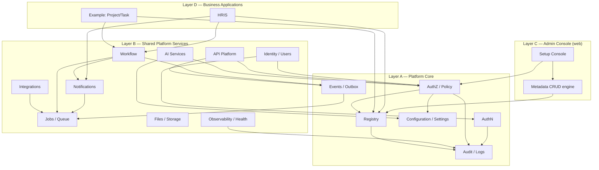

# Platform modules and dependencies

A module is a bounded unit of the modular monolith. This document lists the modules,
their layer, their state, and the allowed dependency direction. It is the reference
used when adding a module or a business application.

## 1. Dependency rules

1. Dependencies point **inward/downward**: Layer D → C → B → A. Core never imports an
   application.
- A module may depend on Platform Core and on other Layer B services through their
  public interfaces.
- Cross-module access goes through a service interface, never another module's
  repository/schema.
- Shared contracts live in `@hris/shared-types`; shared configuration constants in
  `@hris/config`. No framework code in shared packages.
- A business application registers through the registry and event contracts; it does
  not edit core source.

## 2. Module dependency diagram

## Module inventory

| Module | Layer | State | Depends on |
| --- | --- | --- | --- |
| Registry (apps/modules/resources/fields/actions) | A | **Planned (Phase 1)** | Audit |
| Configuration / Settings | A | Exists | Audit |
| AuthN | A | Exists | Audit, Notifications |
| AuthZ / Policy | A | Exists (scope enforcement planned) | Registry, Settings, Audit |
| Audit / Logs | A | Exists | — |
| Events / Outbox | A | Planned | Jobs |
| Identity / Users | B | Exists | AuthN, AuthZ, Audit |
| Workflow / Business rules | B | Planned | Events, Notifications, AuthZ |
| Notifications | B | Exists | Settings, Jobs, Audit |
| Integrations | B | Partial (email) | Jobs, Settings, AuthZ |
| Jobs / Queue | B | Exists | — |
| Files / Storage | B | Infra only | AuthZ, Audit |
| Observability / Health | B | Exists | — |
| API Platform | B | Planned | AuthZ, Events, Audit |
| Data governance | B | Planned | Files, Audit |
| AI Services | B | Planned (optional) | AuthZ, Settings, Audit |
| Admin Console + CRUD engine | C | Exists (bespoke) | Registry, AuthZ |
| HRIS application | D | Partial | Registry, AuthZ, Notifications, Workflow |
| Example Project/Task app | D | Planned | Registry, AuthZ |

## Extension points

Applications extend the platform by **registering data**, never by editing core:

1. **Application + module** registration in the registry.
2. **Resource + field** registration (with validation, list/detail layout, API policy).
3. **Action** registration (including custom actions with a server-side handler).
4. **Navigation** entries generated from registered modules/resources.
5. **Permission resources** derived from registry entries.
6. **Events** publication and **event handler** subscription.
7. **Workflow definitions** referencing registered resources/events.
8. **Notification types/templates** referencing registered event keys.
9. **Configuration schemas** and **feature flags**.
10. **Reports / custom UI** registered against resources (later phase).

## Deployment boundaries

- One API process, one worker process, one web process, one Postgres, one Redis, one
  object store. Registry metadata is part of the API database.
- Optional services (AI, integrations) deploy as additional code paths inside the
  same processes, enabled by configuration, not as mandatory external dependencies.
